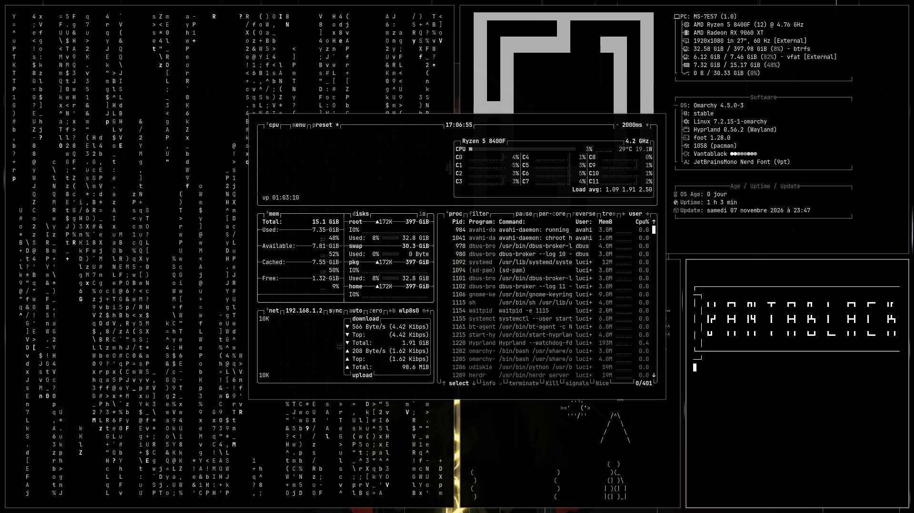

# Omarchy · Vantablack rice

My [Omarchy](https://omarchy.org) setup, down to the last plugin: packages,
Hyprland config, Omarchy shell plugins, an AI depth-parallax wallpaper that
follows the cursor (with animated rain), theme and background.




## Install

On a fresh Omarchy (captured on **4.5.0-3**, x86_64), one line:

```bash
curl -fsSL https://raw.githubusercontent.com/realycracked/omarchy-vantablack-rice/main/bootstrap.sh | bash
```

Preview first, nothing is changed:

```bash
curl -fsSL https://raw.githubusercontent.com/realycracked/omarchy-vantablack-rice/main/bootstrap.sh | bash -s -- --dry-run
```

Or by hand:

```bash
git clone https://github.com/realycracked/omarchy-vantablack-rice.git
cd omarchy-vantablack-rice
./install.sh --dry-run
./install.sh
```

`install.sh` can be run again at any time:

- pacman and AUR packages are installed with `--needed`
- every file it would overwrite is backed up to `~/.rice-backup/<date>/`
- Omarchy shell plugins from GitHub are cloned **pinned to the exact commit**
- `--no-packages` skips pacman/AUR and only applies configs, plugins and theme

## What's in it

| | |
|---|---|
| **Keyboard shortcuts** | all 249 bindings listed in [KEYBINDINGS.md](KEYBINDINGS.md), ★ = added or changed here (AZERTY fixes, Firefox, show desktop, flea, finer resizing) |
| `home/.config/hypr/` | Hyprland (Lua): bindings, AZERTY keys, KDE-style snapping, gaps, layer order, autostart |
| **Wallpaper** | `home/.config/quickshell/zenitsu/` (QML + GLSL depth shader) and its layers in `home/.local/share/zenitsu-wall/` |
| **Theme & CSS** | Vantablack + background, Firefox chrome/content CSS (`home/.config/omarchy/firefox/`, kept in sync with the theme by a user service), Spotify via Spicetify (`Themes/omarchy`, follows the Omarchy theme), GTK dark theme and icons (`packages/dconf/`) |
| **File managers** | [flea](https://github.com/thisisgm/flea) as default (`Super+Shift+F`, also the file picker) with its view settings; Nautilus settings, scripts and extensions |
| **Omarchy plugins** | from GitHub, pinned: ai-usagebar, radio-atlas, omacast — local: **Minuteur** (timer → notify / suspend / shut down, bar + desktop widget), sysmon, VantaMic, reboot-to-Windows, Superwhisper panel |
| `home/.config/omarchy/` | bar layout (`shell.json`), menu, hooks, branding, Secure Boot helper |
| **Packages** | `packages/pacman.txt` (Steam, Spotify, Zen, Neovim, wine, cmatrix, sl, toilet, asciiquarium…), `packages/aur.txt` (ai-usagebar, ble.sh, spicetify, zapzap) |
| everything else | nvim, btop, foot, superwhisper, ble.sh, git, mime types, user services |
| `tools/` | `make_layers.py` (wallpaper from any image), `keybindings.py` (KEYBINDINGS.md) |

## The wallpaper

A Quickshell layer surface draws the image through a small shader that shifts
each pixel by its depth as the cursor moves; the cursor position comes from
Hyprland's socket. Two particle systems draw rain, and the sword's glow
flickers. About 215 MB RAM and 3 % CPU.

To use another image:

```bash
uv run --with onnxruntime --with opencv-python-headless --with numpy --with huggingface_hub \
  python tools/make_layers.py my-image.png ~/.local/share/zenitsu-wall --glow
pkill -f '^qs -c zenitsu'; setsid -f qs -c zenitsu
```

Settings (strength, smoothing, rain amount) are at the top of
`~/.config/quickshell/zenitsu/shell.qml`.

## Keep it in sync

On the machine this was captured from:

```bash
./sync.sh && git diff   # capture the current state, review, commit
```

## Not automated

- **Claude Code plugins** sync with the Claude account: sign in to Claude and they come back.
- **VantaMic** (phone mic + camera; its bar plugin is included) is a separate project, built with its PKGBUILD.
- Secure Boot (`~/.config/omarchy/secureboot.sh`) stays a manual, step-by-step script.
- Browser profiles, keys and tokens are never captured.

## Credits

- [Omarchy](https://omarchy.org) and its Vantablack theme
- Plugins: [ai-usagebar](https://github.com/akitaonrails/ai-usagebar), [omarchy-radio-atlas](https://github.com/AksharP5/omarchy-radio-atlas), [oma-cast](https://github.com/typecraft-dev/oma-cast)
- Models: [BiRefNet](https://github.com/ZhengPeng7/BiRefNet), [Depth Anything V2](https://github.com/DepthAnything/Depth-Anything-V2)
- Wallpaper art: Zenitsu (Demon Slayer) fan art — source to credit before making the repo public
